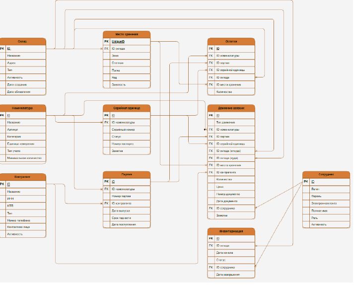
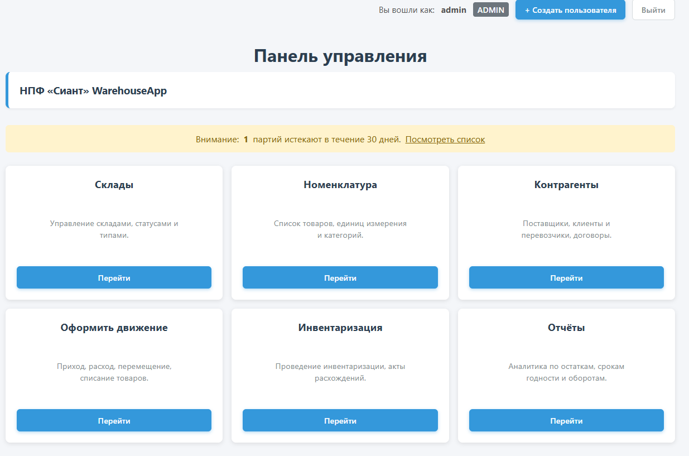
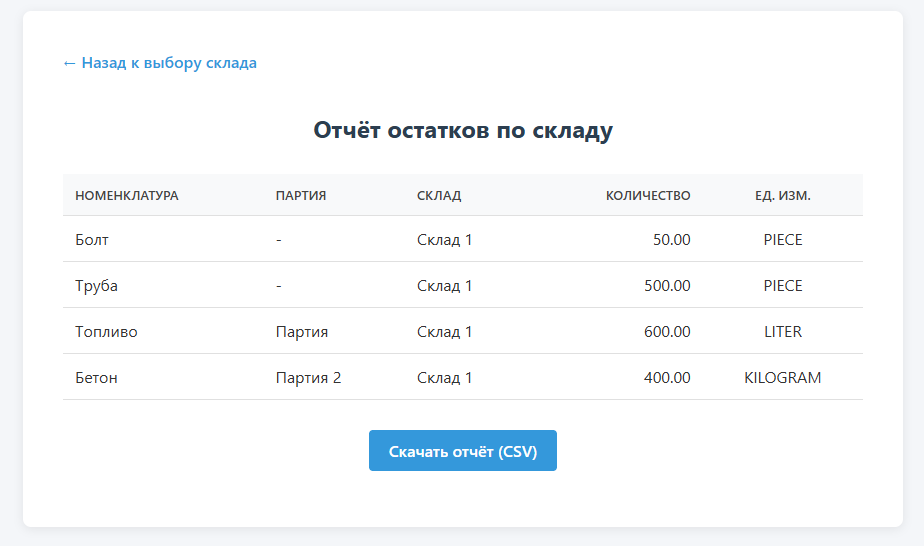
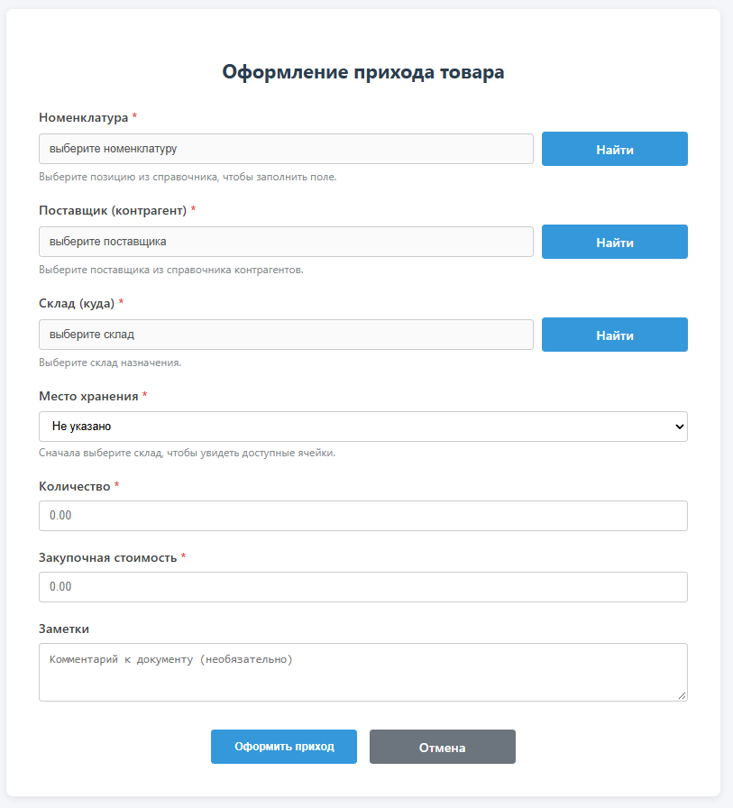
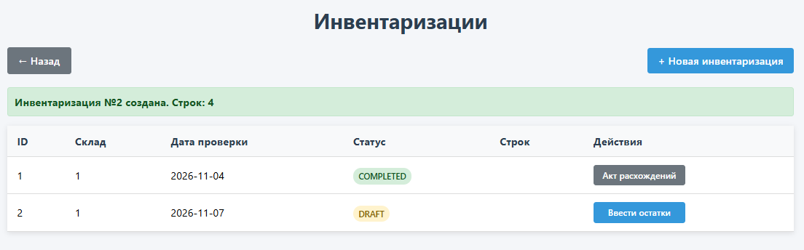
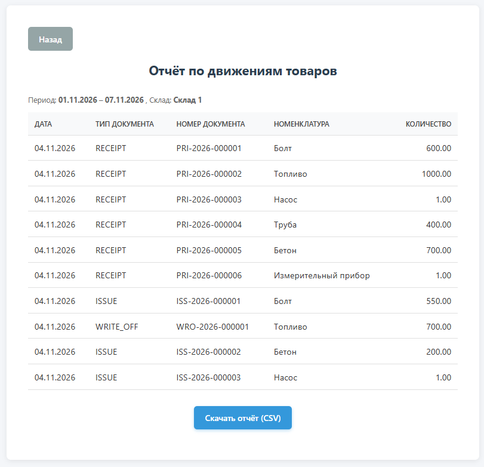
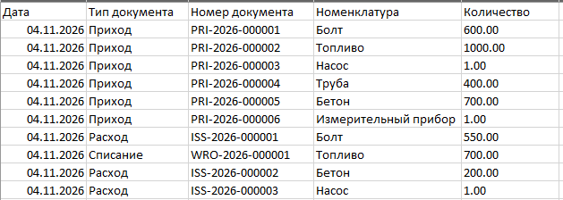

# WarehouseApp — система складского учета материалов и оборудования

Автоматизированная система складского учета для небольшой подрядной организации нефтегазовой отрасли (на примере НПФ «Сиант»): справочники с отраслевой спецификой, партионный и серийный учет, движение запасов (приход, расход, перемещение, списание), инвентаризация, контроль сроков годности, адресное хранение, отчетность с экспортом в CSV, REST API и журналирование действий пользователей. Данные размещаются на локальном сервере организации, без лицензионных платежей за инструментарий.

## Содержание

1. [Требования к окружению](#требования-к-окружению)
2. [Технологический стек](#технологический-стек)
3. [Структура проекта](#структура-проекта)
4. [Доменная модель](#доменная-модель)
5. [ER-схема базы данных](#er-схема-базы-данных)
6. [Функциональность](#функциональность)
7. [Импорт из CSV](#импорт-из-csv)
8. [REST API](#rest-api)
9. [Обработка ошибок](#обработка-ошибок)
10. [Безопасность и аудит](#безопасность-и-аудит)
11. [Учётные записи](#учётные-записи)
12. [Скриншоты интерфейса](#скриншоты-интерфейса)
13. [Тестирование](#тестирование)
14. [Запуск](#запуск)

## Требования к окружению

| Компонент  | Версия | Примечание                                                           |
|------------|--------|----------------------------------------------------------------------|
| JDK        | 21+    | проект собирается и на более новых версиях (проверено на OpenJDK 24) |
| PostgreSQL | 17     | поставляется в docker-compose (`postgres:17-alpine`)                 |
| Docker     | —      | запуск базы данных и полный вариант развертывания                    |
| Maven      | 3.8+   | сборка и запуск в режиме разработки                                  |

## Технологический стек

| Технология                       | Версия | Назначение                              |
|----------------------------------|--------|-----------------------------------------|
| Java                             | 21     | язык разработки                         |
| Spring Boot                      | 3.5.12 | каркас приложения                       |
| Spring Data JPA (Hibernate)      | —      | доступ к данным, ORM                    |
| Spring Security                  | —      | аутентификация и разграничение прав     |
| PostgreSQL                       | 17     | СУБД                                    |
| Thymeleaf                        | —      | серверные HTML-шаблоны и печатные формы |
| Flyway                           | —      | миграции БД                             |
| springdoc-openapi                | —      | Swagger-документация REST API           |
| Lombok                           | —      | сокращение шаблонного кода              |
| JUnit 5, Mockito, Testcontainers | —      | модульные и интеграционные тесты        |

## Структура проекта

src/main/java/com/example/warehouseApp 

├── controller # веб-контроллеры (Thymeleaf) и REST-контроллеры 

├── domain # JPA-сущности 

├── dto # транспортные объекты API и форм 

├── exception # пользовательские исключения и ErrorHandler 

├── mapper # мапперы сущность ↔ DTO 

├── model # перечисления (enum) и вспомогательные модели 

├── parser # CSV-парсеры импорта 

├── repository # Spring Data JPA репозитории 

├── security # конфигурация Spring Security, инициализация пользователей 

├── service # бизнес-логика 

├── specification # динамические фильтры списков (JPA Specification) 

└── util # утилиты

## Доменная модель

| Сущность                       | Назначение                                   | Ключевые поля                                                                   |
|--------------------------------|----------------------------------------------|---------------------------------------------------------------------------------|
| Warehouse                      | склад (центральный / удаленный)              | name, address, type (CENTRAL, REMOTE), active                                   |
| StorageLocation                | адресная ячейка склада                       | warehouseId, zone, rack, shelf, code (A-03-02), used                            |
| Counterparty                   | контрагент (поставщик/покупатель/внутренний) | name, inn, kpp, type, contact, phone, active                                    |
| Nomenclature                   | номенклатура                                 | name, sku, category, unit, inventoryType (BATCH/SERIAL/QUANTITY), active        |
| Batch                          | партия (для реагентов, труб)                 | nomenclatureId, batchNumber, supplierId, productionDate, expiryDate, status     |
| SerialItem                     | серийная единица (УЭЦН, телесистемы)         | nomenclatureId, serialNumber, batchId, status, passportNumber, notes            |
| StockBalance                   | остаток                                      | nomenclatureId, batchId, serialItemId, warehouseId, storageLocationId, quantity |
| Movement                       | документ движения                            | type (RECEIPT/ISSUE/TRANSFER/WRITE_OFF), склады, количество, цена, документ     |
| InventoryCheck / InventoryLine | инвентаризация и её строки                   | учётное/фактическое количество, расхождение                                     |
| User                           | пользователь                                 | username, password (BCrypt), email, fullName, role, active                      |
| AuditLog                       | журнал действий                              | userId, username, action, entityType, entityId, timestamp, details (JSONB)      |

## ER-схема базы данных



На схеме отражены связи:

- Nomenclature → Batch (одна номенклатура — много партий) и Nomenclature → SerialItem;
- Batch → SerialItem (партия, к которой принадлежит серийная единица);
- Counterparty → Batch (поставщик партии);
- Warehouse → StorageLocation (ячейки склада);
- StockBalance → Nomenclature, Warehouse, StorageLocation, Batch, SerialItem (остаток собирает все справочники);
- Movement → Nomenclature, Warehouse (откуда), WarehouseTo (куда), Counterparty, Batch, SerialItem, StorageLocation;
- InventoryCheck → Warehouse, InventoryLine → InventoryCheck и Nomenclature/Batch;
- User → AuditLog (по userId).

## Функциональность

### Справочники

- **Склады** — CRUD с типами CENTRAL/REMOTE; склад с остатками удалить нельзя.
- **Номенклатура** — справочник материалов и оборудования с отраслевой спецификой: артикул (уникальный), категории (MATERIAL, EQUIPMENT, TOOL, SIZ, FUEL), единицы измерения, тип учёта (партионный, серийный, количественный), минимальный остаток. Список с фильтрами по категории и типу, пагинация.
- **Контрагенты** — поставщики, покупатели и внутренние подразделения; ИНН и КПП.
- **Адресное хранение** — ячейки в формате «зона-стеллаж-полка» (A-03-02), фильтр по складу.
- **Партии** — дата изготовления, срок годности, поставщик; фильтры по номенклатуре и сроку годности.
- **Серийные единицы** — серийный номер, номер паспорта, заметки; статусы: На складе, В эксплуатации, В ремонте, Списан, В перемещении.

### Движение запасов

- **Приход** — документ приёмки увеличивает остаток; выбор склада, номенклатуры, партии (для BATCH), серийника (для SERIAL), цены и контрагента; всё в одной транзакции.
- **Расход** — отгрузка с контролем остатков: отрицательные остатки блокируются; для серийных единиц проверяется наличие на складе и статус «На складе», после отгрузки статус меняется на «В эксплуатации». Выбор партии по FIFO (по дате прихода).
- **Перемещение** — перенос остатков между складами; для серийных единиц меняется привязка к складу. Журнал перемещений с фильтрами по датам и складам.
- **Списание** — списание с обязательной причиной: истечение срока (EXPIRY), порча (DAMAGE), недостача (LOSS), износ (WEAR); серийные единицы получают статус «Списан».
- **Печатные формы** — приходные и расходные документы, акт расхождений инвентаризации выгружаются в виде HTML-форм для печати.

### Контроль сроков годности

- Ежедневный планировщик (8:00) пересчитывает статусы партий: ACTIVE, EXPIRING_SOON (истекает в течение 30 дней), EXPIRED.
- Виджет на главной странице с количеством истекающих партий и переходом на список.
- Страница «Контроль сроков годности» с подсветкой: зелёный — активна, жёлтый — истекает, красный — просрочена.

### Инвентаризация

- Создание проверки по складу: строки заполняются учётными остатками автоматически.
- Кладовщик вводит фактические количества; система рассчитывает расхождения.
- Завершение проверки формирует корректирующие движения: списание недостач и оприходование излишков, с актом расхождений.

### Отчёты

- Остатки по складу на дату.
- Движение за период по складу (или по всем складам).
- Оборачиваемость с ABC-анализом.
- Неликвиды (позиции без движения дольше N дней).
- Дефицит (остаток ниже минимального порога).
- Сроки годности (список партий с датами истечения).
- Экспорт каждого отчёта в CSV; сводка на дашборде: стоимость остатков, позиции с дефицитом, истекающие партии.

### REST API и поддержка отложенных операций

- REST-контроллеры для справочников, движения и инвентаризации (см. раздел «REST API»).
- `/api/sync` — приём пакета операций, накопленных на удалённой площадке при отсутствии устойчивой связи; каждый элемент пакета несёт уникальный идентификатор (идемпотентность повторной отправки).
- DTO для входных и выходных данных — сущности наружу не отдаются.
- Swagger UI — интерактивная документация эндпойнтов.

### Пользователи, роли и аудит

- Аутентификация через форму логина, пароли — BCrypt.
- Роли: ADMIN, STOREKEEPER, VIEWER — с матрицей прав (см. «Безопасность и аудит»).
- Аудит через AOP-аспект `@LogAudit`: каждое создание/изменение/удаление записывается в журнал с пользователем, временем и JSON-подробностями.
- Страница «Журнал действий» с фильтрами — доступна только администратору.

## Импорт из CSV

Массовая загрузка данных из CSV-файлов через REST API — для первоначального наполнения и переноса данных из таблиц Excel. Импорт доступен ролям ADMIN и STOREKEEPER (импорт складов — только ADMIN).

**Импортируемые сущности:** склады, контрагенты, номенклатура, партии, серийные единицы, остатки.

**Общие правила:**

- кодировка UTF-8 (с BOM или без), разделитель — `;`, первая строка — заголовки; названия колонок распознаются по синонимам, регистр не важен (например, для номенклатуры: «название», «наименование», «name»);
- регистронезависимый поиск по артикулу, названию, номеру партии и серийному номеру;
- пустые строки пропускаются;
- строки с ошибками не прерывают импорт: валидные строки записываются, проблемные попадают в отчёт об ошибках с указанием номера строки;
- повторная загрузка обновляет существующие записи (upsert) вместо создания дублей;
- ключи upsert: склады — название; контрагенты — ИНН; номенклатура — артикул; партии — номер партии; серийные единицы — серийный номер; остатки — комбинация «номенклатура + склад + партия + серийная единица».

**Порядок первой загрузки** (импорт ссылается на ранее загруженные справочники):

1. склады → 2. контрагенты → 3. номенклатура → 4. партии → 5. серийные единицы → 6. остатки.

**Форматы файлов:**

- Склады (`/api/warehouse/import.html`): 

название;адрес;тип 

Центральный склад;г. Нижневартовск центральный Склад ГСМ;удалённый


- Контрагенты (`/api/counterparty/import`):

название организации;инн;кпп;тип;номер телефона;контактное лицо 

ООО СеверСтрой;1111111111;111101001;поставщик;+7 900 000-00-00;Иванов Иван


- Номенклатура (`/api/nomenclature/import.html`):

название;артикул;категория;ед.измерения;тип;мин.количество 

Труба сталь 73мм;100001;материал;м;количественный;50 

УЭЦН-5-125;100003;оборудование;шт;серийный


- Партии (`/api/batch/import`):

номенклатура;номер партии;инн;дата изготовления;срок годности 

100003;партия-001;1111111111;01.01.2026;01.01.2027 

100001;партия-003;;20.10.2026;20.10.2028


Валидация: дата производства не в будущем, срок годности не в прошлом, срок годности позже даты производства; 

формат дат — дд.ММ.гггг (также принимается гггг-ММ-дд). Контрагент указывается по ИНН и может отсутствовать. Статус при загрузке — ACTIVE.


- Серийные единицы (`/api/serial-item/import`):

номенклатура;серийный номер;статус;паспорт;заметки 

100003;SN-0001;в эксплуатации;П-2024-001;выдана бригаде 

100003;SN-0002;на складе;П-2024-002;


Статусы передаются человекочитаемыми названиями («на складе», «в эксплуатации»), регистр не важен; заметки — необязательны.


- Остатки (`/api/import`):

номенклатура;партия;серийная единица;склад;ячейка;количество 

100003;партия-001;;Центральный склад;;500.00 

100007;;SN-0001;Центральный склад;A-1-10;120.50


Количество должно быть больше нуля; ячейка ищется в пределах указанного склада; если серийная единица привязана к партии, 

партия подтягивается автоматически; ячейка, указанная в остатке, помечается как занятая.

## REST API

Документация генерируется автоматически: Swagger UI — `/swagger-ui.html`, OpenAPI JSON — `/v3/api-docs`. Ниже — перечень эндпойнтов.

### Справочники

| Метод  | Путь                            | Параметры          | Роли                       |
|--------|---------------------------------|--------------------|----------------------------|
| GET    | `/api/warehouse`                | page, size, search | ADMIN, STOREKEEPER, VIEWER |
| GET    | `/api/warehouse/{id}`           | —                  | ADMIN, STOREKEEPER, VIEWER |
| POST   | `/api/warehouse`                | —                  | ADMIN                      |
| PATCH  | `/api/warehouse`                | —                  | ADMIN                      |
| DELETE | `/api/warehouse/{id}`           | —                  | ADMIN                      |
| POST   | `/api/warehouse/import.html`    | file (CSV)         | ADMIN                      |
| GET    | `/api/counterparty`             | page, size, search | ADMIN, STOREKEEPER, VIEWER |
| GET    | `/api/counterparty/{id}`        | —                  | ADMIN, STOREKEEPER, VIEWER |
| POST   | `/api/counterparty`             | —                  | ADMIN, STOREKEEPER         |
| PATCH  | `/api/counterparty`             | —                  | ADMIN, STOREKEEPER         |
| DELETE | `/api/counterparty/{id}`        | —                  | ADMIN                      |
| POST   | `/api/counterparty/import`      | file (CSV)         | ADMIN, STOREKEEPER         |
| GET    | `/api/nomenclature`             | page, size, search | ADMIN, STOREKEEPER, VIEWER |
| GET    | `/api/nomenclature/{id}`        | —                  | ADMIN, STOREKEEPER, VIEWER |
| POST   | `/api/nomenclature`             | —                  | ADMIN, STOREKEEPER         |
| PATCH  | `/api/nomenclature`             | —                  | ADMIN, STOREKEEPER         |
| DELETE | `/api/nomenclature/{id}`        | —                  | ADMIN                      |
| POST   | `/api/nomenclature/import.html` | file (CSV)         | ADMIN, STOREKEEPER         |
| GET    | `/api/storageLocation`          | page, size, search | ADMIN, STOREKEEPER, VIEWER |
| GET    | `/api/storageLocation/{id}`     | —                  | ADMIN, STOREKEEPER, VIEWER |
| POST   | `/api/storageLocation`          | —                  | ADMIN, STOREKEEPER         |
| PATCH  | `/api/storageLocation`          | —                  | ADMIN, STOREKEEPER         |
| DELETE | `/api/storageLocation/{id}`     | —                  | ADMIN                      |
| GET    | `/api/batch`                    | page, size, search | ADMIN, STOREKEEPER, VIEWER |
| GET    | `/api/batch/{id}`               | —                  | ADMIN, STOREKEEPER, VIEWER |
| POST   | `/api/batch`                    | —                  | ADMIN, STOREKEEPER         |
| PATCH  | `/api/batch`                    | —                  | ADMIN, STOREKEEPER         |
| DELETE | `/api/batch/{id}`               | —                  | ADMIN                      |
| POST   | `/api/batch/import`             | file (CSV)         | ADMIN, STOREKEEPER         |
| GET    | `/api/serial-item`              | page, size, search | ADMIN, STOREKEEPER, VIEWER |
| GET    | `/api/serial-item/{id}`         | —                  | ADMIN, STOREKEEPER, VIEWER |
| POST   | `/api/serial-item`              | —                  | ADMIN, STOREKEEPER         |
| PATCH  | `/api/serial-item`              | —                  | ADMIN, STOREKEEPER         |
| DELETE | `/api/serial-item/{id}`         | —                  | ADMIN                      |
| POST   | `/api/serial-item/import`       | file (CSV)         | ADMIN, STOREKEEPER         |

### Движение запасов и остатки

| Метод | Путь                  | Параметры                           | Роли                       |
|-------|-----------------------|-------------------------------------|----------------------------|
| GET   | `/api/stock-balances` | warehouseId (необяз.)               | все аутентифицированные    |
| POST  | `/api/import`         | file (CSV)                          | ADMIN, STOREKEEPER         |
| POST  | `/api/receipt`        | —                                   | ADMIN, STOREKEEPER         |
| POST  | `/api/issue`          | —                                   | ADMIN, STOREKEEPER         |
| POST  | `/api/transfer`       | —                                   | ADMIN, STOREKEEPER         |
| POST  | `/api/writeoff`       | —                                   | ADMIN, STOREKEEPER         |
| GET   | `/api/movements`      | search, page, size, sortBy, sortDir | ADMIN, STOREKEEPER, VIEWER |

### Документы и акты

| Метод | Путь                                      | Параметры | Роли               |
|-------|-------------------------------------------|-----------|--------------------|
| POST  | `/api/end-act/write-off/{actId}/complete` | reason    | ADMIN, STOREKEEPER |
| POST  | `/api/end-act/receipt/{actId}/complete`   | source    | ADMIN, STOREKEEPER |

### Инвентаризация

| Метод | Путь                                       | Параметры   | Роли                       |
|-------|--------------------------------------------|-------------|----------------------------|
| GET   | `/api/inventory/checks`                    | —           | ADMIN, STOREKEEPER, VIEWER |
| GET   | `/api/inventory/checks/{id}`               | —           | ADMIN, STOREKEEPER, VIEWER |
| GET   | `/api/inventory/checks/{checkId}/lines`    | —           | ADMIN, STOREKEEPER         |
| POST  | `/api/inventory/checks`                    | warehouseId | ADMIN, STOREKEEPER         |
| PUT   | `/api/inventory/lines/{lineId}/actual-qty` | qty         | ADMIN, STOREKEEPER         |
| POST  | `/api/inventory/checks/{checkId}/complete` | —           | ADMIN, STOREKEEPER         |
| POST  | `/api/inventory/acts/{actId}/settle`       | —           | ADMIN, STOREKEEPER         |

### Отчёты и аналитика

| Метод | Путь                             | Параметры                                 | Роли                       |
|-------|----------------------------------|-------------------------------------------|----------------------------|
| GET   | `/api/reports/stock-balance`     | warehouseId                               | ADMIN, STOREKEEPER, VIEWER |
| GET   | `/api/reports/stock-balance/csv` | warehouseId                               | ADMIN, STOREKEEPER, VIEWER |
| GET   | `/api/reports/movement`          | warehouseId (необяз.), startDate, endDate | ADMIN, STOREKEEPER, VIEWER |
| GET   | `/api/reports/movement/csv`      | те же                                     | ADMIN, STOREKEEPER, VIEWER |
| GET   | `/api/reports/turnover`          | warehouseId (необяз.), startDate, endDate | ADMIN, STOREKEEPER, VIEWER |
| GET   | `/api/reports/turnover/csv`      | те же                                     | ADMIN, STOREKEEPER, VIEWER |
| GET   | `/api/reports/deficit`           | warehouseId                               | ADMIN, STOREKEEPER, VIEWER |
| GET   | `/api/reports/deficit/csv`       | warehouseId                               | ADMIN, STOREKEEPER, VIEWER |
| GET   | `/api/reports/nonliquid`         | warehouseId                               | ADMIN, STOREKEEPER, VIEWER |
| GET   | `/api/reports/nonliquid/csv`     | warehouseId                               | ADMIN, STOREKEEPER, VIEWER |
| GET   | `/api/analytics/expiry-control`  | search, page, size                        | все аутентифицированные    |

### Прочее

| Метод | Путь                | Параметры | Роли  |
|-------|---------------------|-----------|-------|
| POST  | `/api/sync`         | —         | ADMIN |
| POST  | `/api/users/create` | —         | ADMIN |

### Коды ответов импорта CSV

| Код | Ситуация                                                                                           |
|-----|----------------------------------------------------------------------------------------------------|
| 200 | Импорт выполнен; в ответе created, updated, imported, а при наличии ошибок — skipped и их перечень |
| 400 | Файл не выбран, пуст, ни одна строка не прошла валидацию                                           |
| 500 | Не удалось прочитать файл                                                                          |

Пример успешного ответа:

```json
{
  "created": 12,
  "updated": 3,
  "imported": 15,
  "skipped": 1,
  "errors": ["Строка 7: номенклатура с артикулом «100099» не найдена"]
}
```

## Обработка ошибок

Глобальный обработчик ErrorHandler (@RestControllerAdvice) возвращает единый формат ErrorResponse с человекочитаемым сообщением:

| Код | 	Исключение                      | 	Типичная ситуация                                                            |
|-----|---------------------------------|------------------------------------------------------------------------------|
| 400 | 	MethodArgumentNotValidException | 	нарушение валидации полей DTO (@Valid)                                       |
| 400 | 	HttpMessageConversionException  | 	некорректный JSON или тип данных в запросе                                   |
| 400 | 	ValidationException             | 	нарушение бизнес-валидации (например, неверные даты партии)                  |
| 400 | 	IllegalArgumentException        | 	некорректные параметры запроса (warehouseId <= 0, startDate > endDate)       |
| 404 | 	NotFoundException               | 	сущность не найдена по идентификатору                                        |
| 409 | 	AlreadyExistsException          | 	нарушение уникальности (дубликат артикула, логина)                           |
| 409 | 	BusinessException               | 	нарушение бизнес-правил (отрицательный остаток, удаление склада с остатками) |

## Безопасность и аудит

Аутентификация. Форма логина Spring Security (formLogin), пароли хранятся в виде BCrypt-хэшей. Тестовые пользователи создаются автоматически при первом запуске.

Разграничение прав. Двухуровневая защита: правила доступа по URL и методам в SecurityConfig плюс аннотации @PreAuthorize на контроллерах.

### Матрица прав:

| Действие                                           | 	ADMIN | 	STOREKEEPER | 	VIEWER |
|----------------------------------------------------|-------|-------------|--------|
| Просмотр справочников, остатков, движений, отчётов | 	+     | 	+           | 	+      |
| Создание и изменение справочников и документов     | 	+     | 	+           | 	—      |
| Импорт CSV                                         | 	+     | 	+           | 	—      |
| Удаление записей                                   | 	+     | 	—           | 	—      |
| Создание складов и управление пользователями       | 	+     | 	—           | 	—      |
| Офлайн-синхронизация (/api/sync)                   | 	+     | 	—           | 	—      |

CSRF-защита включена для веб-форм (Thymeleaf) и отключена для /api/** — REST-клиенты и мобильное приложение не передают CSRF-токен.

### Аудит

AOP-аспект перехватывает методы, отмеченные аннотацией @LogAudit(action = "...", entityType = ...), и записывает в 
таблицу audit_log: пользователя, действие (CREATE/UPDATE/DELETE), тип и идентификатор сущности, время и JSON-подробности вызова 
(метод, аргументы, результат). Бинарные данные (файлы CSV-импорта) в журнал не попадают. Журнал доступен администратору 
с фильтрами по пользователю, типу действия и датам.

### Учётные записи

При первом запуске автоматически создаются тестовые пользователи (см. DatabaseInitializer):

| Логин       | 	Пароль   | 	Роль        |
|-------------|----------|-------------|
| admin       | 	admin123 | 	ADMIN       |
| storekeeper | 	store123 | 	STOREKEEPER |
| viewer      | 	view123  | 	VIEWER      |

Учётные записи предназначены для проверки и демонстрации; в боевом контуре пароли следует сменить, а автосоздание — отключить.

## Скриншоты интерфейса

Главная страница с виджетом сроков годности



Список остатков



Форма приемки



Форма инвентаризации



Отчет с экспортом в CSV




### Тестирование

Тесты репозитория — проверка поисковых запросов, спецификаций, пагинации и ограничений уникальности.
Тесты контроллеров — MockMvc: маршруты, коды ответов, валидация форм, редиректы и flash-сообщения; проверка прав доступа по ролям (@WithMockUser).
Интеграционные тесты — @SpringBootTest с Testcontainers (PostgreSQL): сквозной цикл «приход → перемещение → отгрузка → инвентаризация», проверка транзакционности (откат при ошибке), импорт CSV на реальном стеке.

## Запуск

Вариант 1 — полное развертывание: три контейнера (БД, приложение, Nginx на порту 80):

docker compose up -d

Приложение доступно по адресу http://localhost.

Вариант 2 — режим разработки: база поднимается в контейнере, приложение запускается локально:

1. Поднять базу данных

docker compose up -d db

2. Запустить приложение

mvn spring-boot:run

Приложение доступно на http://localhost:8080, Swagger UI — на http://localhost:8080/swagger-ui.html

Конфигурация подключения к БД (application.yml): host localhost, порт 5433, база warehouse_db, пользователь warehouse_user — 
совпадает с пробросом порта в docker-compose (5433:5432).


